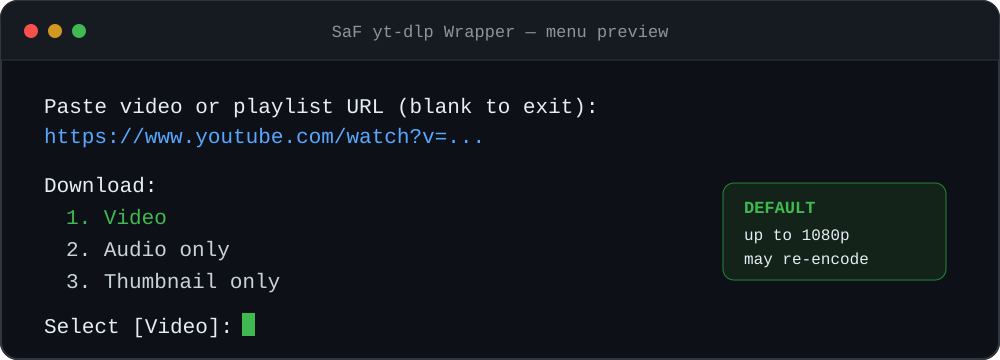

<div align="center">

<h1>🎬 SaF yt-dlp Wrapper</h1>

<p><strong>Language:</strong> <strong>English</strong> · <a href="README.ru.md">Русский</a></p>

<p><strong>Download YouTube videos and playlists without installing yt-dlp or FFmpeg yourself</strong></p>

<p>
  <a href="https://github.com/Aspirata/SaF-YT-DLP-Wrapper/actions/workflows/test.yml"></a>
  
  <a href="LICENSE"></a>
</p>

<p><strong><a href="https://github.com/Aspirata/SaF-YT-DLP-Wrapper/releases">⬇️ Download the latest release</a></strong> · <a href="#what-is-this-program-for">About</a> · <a href="#quick-start">Quick start</a> · <a href="#technical-reference">Technical reference</a></p>

</div>

> **Default setup:** the best available video up to **1080p** in MP4, with one audio track for each available language. The `MODERN` profile may re-encode video or audio when the source formats require it.

## What is this program for?

SaF is a portable, interactive wrapper around **[yt-dlp](https://github.com/yt-dlp/yt-dlp)** for downloading YouTube videos and playlists. Paste a URL, choose video, audio only, or a thumbnail, and find the result in `Downloads`. The wrapper fetches its own yt-dlp, Deno, [FFmpeg](https://ffmpeg.org/), and FFprobe copies and handles format selection and file assembly for you.

- **Compared with a basic video downloader:** you get audio tracks for every available language, chapters and metadata, plus codec and compatibility profiles. `QUALITY` can preserve the source streams when VP9 conversion is disabled.
- **Compared with running yt-dlp directly:** you do not have to install its dependencies yourself or work out format-selection and FFmpeg options. The simple menu covers everyday downloads; `config.ini` exposes the advanced choices.

> [!WARNING]
> **Using cookies from a Chromium-based browser? Close it completely first**, including background processes (for example, Chrome, Chromium, Edge, or Brave). Otherwise its locked cookie database may prevent the download. **Firefox can stay open** when the wrapper reads its cookies. This matters for videos that need a signed-in browser session.

## Quick start

1. Download the archive for your system from [Releases](https://github.com/Aspirata/SaF-YT-DLP-Wrapper/releases): `SaF-yt-dlp-Wrapper-Windows.zip` for Windows or `SaF-yt-dlp-Wrapper-Unix.tar.gz` for Linux and macOS.
2. **Extract the archive** into its own folder. Do not run the launcher from inside the archive.
3. On Windows, run `SaF-YTDLP.cmd`. On Linux or macOS, open a terminal in the extracted folder and run `./SaF-YTDLP.sh`.
4. Paste a YouTube video or playlist URL and press **Enter**. Press **Enter** again to select video. Your files will appear in the `Downloads` folder beside the launcher.



**You do not need to change any settings.** A fresh release uses `MODERN`: it selects the best available video **no higher than 1080p** and produces MP4. Depending on the source codecs, it may copy the streams or re-encode video to H.265 and audio to AAC. If 1080p is unavailable, it selects a lower available resolution.

The first launch needs an internet connection because the wrapper downloads its required components. This may take a few minutes. You can paste another URL into the same window; submit a blank line to exit.

### Want only audio or a thumbnail?

After entering the URL, press `2` for audio only or `3` for the thumbnail. `1` selects video; pressing Enter uses the configured default. With the default settings, the wrapper adds one best audio track for each language YouTube provides for the video.

### Linux and macOS: if the launcher does not start

If the executable permission was lost while extracting or copying the archive, run this in the program folder:

```bash
chmod +x SaF-YTDLP.sh
./SaF-YTDLP.sh
```

The script requires Bash 3.2 or newer and the standard `curl`, `unzip`, `tar`, and `gzip` utilities. Windows, Linux, and macOS on x86_64 and ARM64 are supported; macOS ARM64 means Apple Silicon. YouTube URLs are tested. Other sites are not supported or tested.

---

## ⚙️ Technical reference

The rest of this README describes the profiles, every `config.ini` setting, and the format-selection rules. You can skip it if the defaults give you what you need.

[Profiles](#output-profiles) · [Configuration](#configini-settings) · [Format selection](#how-streams-are-selected) · [FFmpeg](#when-ffmpeg-runs) · [Files and troubleshooting](#files-cookies-and-troubleshooting)

## Output profiles

Set the profile with `PROFILE`. With the default multitrack selection, **resolution and frame rate are compared first**; codec preference breaks ties at the same height and FPS. `MAX_HEIGHT` excludes formats above the configured frame height.

| Profile | Source preference at equal height/FPS | Video output | Audio in video |
| --- | --- | --- | --- |
| `QUALITY` | Prefers native AV1; then compares stream quality indicators. | Copies the source video. It re-encodes selected VP9 to AV1 only if `TRANSCODE_VP9_TO_AV1=YES`. | Copies the source audio tracks. |
| `MODERN` **(default)** | H.265 → H.264 → AV1 → VP9. | Copies H.265 and compatible H.264 (`yuv420p`/`yuvj420p`); converts other codecs to H.265. Produces MP4. | Uses AAC: copies it if every selected track is already AAC, otherwise re-encodes the tracks. |
| `UNIVERSAL` | H.264 → H.265 → AV1 → VP9. | Copies compatible H.264 (`yuv420p`/`yuvj420p`); converts other codecs to H.264. Produces MP4. | Uses the same AAC rule as `MODERN`. |

`QUALITY` keeps the source codec when `TRANSCODE_VP9_TO_AV1=NO`, so playback depends on your player's codec support. `MODERN` produces an MP4 intended for editing; `UNIVERSAL` targets wider device compatibility. Re-encoding takes time and can change quality. Packaging existing streams into MP4 without re-encoding is called *remuxing*.

In **audio-only mode**, `QUALITY` prefers Opus and stores multiple tracks in MP4 by default (`STORE_OPUS_IN_MP4=YES`), or in MKA. If a selected stream is not Opus, multitrack output converts it to Opus. `MODERN` produces M4A/AAC. `UNIVERSAL` produces MP3 when `DOWNLOAD_ALL_AUDIO_TRACKS=NO`; with `YES`, it produces M4A/AAC even when only one language is available. A thumbnail is embedded in the audio file when possible.

## `config.ini` settings

Release archives include a ready-to-use `config.ini`. In the source tree, `config.default.ini` is the release template. The release build copies that template into each archive without changing your local `config.ini`. Edit `config.ini` in a text editor to customize the wrapper. If you run an older extracted copy or the repository checkout, check its existing `config.ini`: it is not reset automatically. Copy the contents of `config.default.ini` into it to use the settings below.

```ini
PROFILE=MODERN
MAX_HEIGHT=1080
DEFAULT_MODE=video
TRANSCODE_VP9_TO_AV1=YES
ALLOW_HARDWARE_TRANSCODING=YES
STORE_OPUS_IN_MP4=YES
DOWNLOAD_ALL_AUDIO_TRACKS=YES
COOKIE_BROWSER=
```

| Setting | Default | Meaning |
| --- | --- | --- |
| `PROFILE` | `MODERN` | `QUALITY`, `MODERN`, or `UNIVERSAL`; see the profile rules above. |
| `MAX_HEIGHT` | `1080` | Maximum video height in pixels. For example, `720` limits selection to 720p; `0` removes the limit. Does not affect audio-only or thumbnail mode. |
| `DEFAULT_MODE` | `video` | Mode selected by pressing Enter in the menu: `video`, `audio`, or `thumbnail`. You can still choose any of the three modes with a number. |
| `TRANSCODE_VP9_TO_AV1` | `YES` | With `YES`, `QUALITY` re-encodes selected VP9 video to AV1. If native AV1 won format selection, no conversion is needed. Does not affect `MODERN` or `UNIVERSAL`. |
| `ALLOW_HARDWARE_TRANSCODING` | `YES` | When video re-encoding is needed, tries an available hardware encoder and uses a software encoder if none works. Has no effect when the video stream can be copied. |
| `STORE_OPUS_IN_MP4` | `YES` | In `QUALITY` audio-only mode, packages Opus in MP4; with `NO`, multitrack output uses MKA. Does not control video re-encoding. |
| `DOWNLOAD_ALL_AUDIO_TRACKS` | `YES` | Selects one best audio track for each available language. With `NO`, uses yt-dlp's usual single-track selection. |
| `COOKIE_BROWSER` | empty | Browser cookie source. Empty enables automatic detection. Allowed names: `chrome`, `chromium` (Linux/macOS), `edge`, `firefox`, `opera`, `brave`, `vivaldi`, `comet`, `zen`. The wrapper saves the first working browser here. |

Use `YES` or `NO` for boolean settings. Invalid profile, mode, number, boolean, or browser values stop the wrapper before downloading. On Windows, `chromium` is not a separate accepted browser name; Chrome/Chromium is checked as `chrome`.

## How streams are selected

With `DOWNLOAD_ALL_AUDIO_TRACKS=YES`, the wrapper asks yt-dlp for the formats available for each video and selects streams separately:

1. **Video:** filters out formats known to exceed `MAX_HEIGHT`, then compares height, FPS, the current profile's codec rank, quality, and bitrate. For example, 1080p VP9 can win over 720p AV1. Under `QUALITY`, only AV1 has an explicit codec preference; the other codecs are compared using the subsequent indicators.
2. **Audio:** groups streams by YouTube language tag and selects one from each group. `QUALITY` prefers Opus; `MODERN` and `UNIVERSAL` prefer AAC. It then favors audio-only streams and compares quality and audio bitrate. Streams without a language tag share an `und` group.
3. **Assembly:** adds the chosen tracks to the video, including languages available only in combined video-and-audio formats. If the selected video format already has audio, its language is not added again. Tracks receive language tags and readable names; the first is marked as the default. YouTube chapters and metadata are embedded.

With `DOWNLOAD_ALL_AUDIO_TRACKS=NO`, yt-dlp format selectors choose one audio track. `MODERN` still preselects video by height, FPS, and codec. `QUALITY` uses yt-dlp sorting by resolution, FPS, and AV1. With a height limit of 1080p or lower, `UNIVERSAL` searches for compatible H.264 within the limit before trying other codecs. In that mode, lower-resolution H.264 can beat a higher-resolution video. Selection is ultimately limited by the formats YouTube exposes for each video.

## When FFmpeg runs

After downloading, FFprobe checks the actual codec, pixel format, and audio tracks. If the streams already meet the profile's requirements, the wrapper either leaves the file alone or repackages it into MP4 with `-c:v copy` and `-c:a copy`. Multitrack video is repackaged to label the audio languages. With the default `MODERN` profile, an FFmpeg step may therefore be a remux or actual re-encoding, depending on the source streams.

When the profile requires a new video codec, the target bitrate is calculated from the source bitrate (or, when needed, from video packet sizes and duration) using a coefficient for the codec pair and resolution band. Software encoding uses two passes; hardware encoding uses one. On Windows the wrapper checks NVIDIA NVENC, Intel QSV, and AMD AMF; on Linux it checks NVENC, QSV, and VAAPI when a device is present; on macOS it checks VideoToolbox for H.264/H.265. If hardware encoding fails, it retries on the CPU. If processing fails, the downloaded source file is kept.

## Files, cookies, and troubleshooting

```text
SaF-YTDLP.cmd / SaF-YTDLP.sh   launchers
config.ini                      your settings
Downloads/                      completed files
internal/dependencies/          portable yt-dlp, Deno, FFmpeg, and FFprobe
internal/temp/                  temporary job files
```

- Existing downloads are never overwritten: matching names receive `(1)`, `(2)`, and so on.
- Temporary files are cleared automatically. If a completed file cannot be moved into `Downloads`, it remains in `internal/temp/job.../downloads` until the next launch.
- For restricted videos, the wrapper tries browser cookies. Close Chromium-based browsers completely before using their cookies; Firefox can stay open. Cookies are read directly from the browser profile; no separate cookie file is exported.
- If component setup was interrupted, launch the wrapper again. To force a clean component download, delete only `internal/dependencies`.
- If `config.ini` is missing, restore it from the release archive. Do not run two copies from the same folder at once: they share `config.ini`, `internal`, and `Downloads`.

## Development

`build-release.cmd` creates the Windows ZIP and Unix tar.gz archives in `dist/`. GitHub Actions tests a live download on Windows, Linux, and macOS for both x64 and ARM64. Building a release does not change the source tree's `config.ini`.

Code by ChatGPT 5.6 Sol (High); project management by the project author. License: [MIT](LICENSE).
