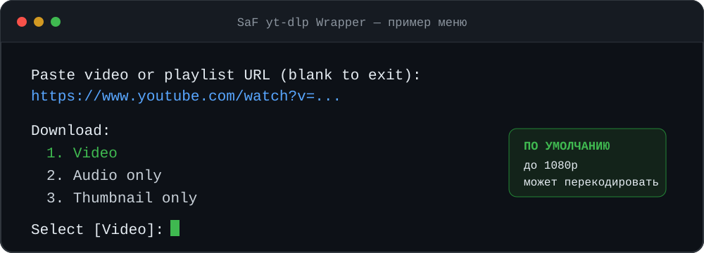

<div align="center">

<h1>🎬 SaF yt-dlp Wrapper</h1>

<p><strong>Язык:</strong> <a href="README.md">English</a> · <strong>Русский</strong></p>

<p><strong>Видео и плейлисты YouTube без ручной установки yt-dlp и FFmpeg</strong></p>

<p>
  <a href="https://github.com/Aspirata/SaF-YT-DLP-Wrapper/actions/workflows/test.yml"></a>
  
  <a href="LICENSE"></a>
</p>

<p><strong><a href="https://github.com/Aspirata/SaF-YT-DLP-Wrapper/releases">⬇️ Скачать последнюю сборку</a></strong> · <a href="#что-это-за-программа-и-зачем-она-нужна">О программе</a> · <a href="#быстрый-старт">Быстрый старт</a> · <a href="#техническая-часть">Техническая часть</a></p>

</div>

> **По умолчанию:** лучшее доступное видео до **1080p** в MP4 и по одной аудиодорожке на каждый доступный язык. Профиль `MODERN` может перекодировать видео или звук, если этого требуют исходные форматы.

## Что это за программа и зачем она нужна?

SaF — портативная оболочка над **[yt-dlp](https://github.com/yt-dlp/yt-dlp)** для скачивания видео и плейлистов YouTube. Вставьте ссылку, выберите видео, только звук или обложку — результат появится в `Downloads`. Программа сама загружает свои копии yt-dlp, Deno, [FFmpeg](https://ffmpeg.org/) и FFprobe, выбирает форматы и собирает готовый файл.

- **По сравнению с простым скачивальщиком видео:** доступны дорожки на всех языках, главы, метаданные и профили совместимости. Профиль `QUALITY` позволяет сохранить исходные потоки, если отключить преобразование VP9.
- **По сравнению с запуском yt-dlp вручную:** не нужно самостоятельно устанавливать зависимости и подбирать параметры выбора форматов и FFmpeg. Для обычной загрузки достаточно простого меню, а дополнительные настройки есть в `config.ini`.

> [!WARNING]
> **Используете куки (cookies) из Chromium-браузера? Сначала полностью закройте его**, включая фоновые процессы (например, Chrome, Chromium, Edge или Brave). Иначе заблокированная база куки может помешать скачиванию. **Firefox можно оставить открытым**: программа читает его куки без закрытия браузера. Это важно для роликов, которым нужна авторизация через браузер.

## Быстрый старт

1. Скачайте архив для своей системы со страницы [Releases](https://github.com/Aspirata/SaF-YT-DLP-Wrapper/releases): `SaF-yt-dlp-Wrapper-Windows.zip` для Windows или `SaF-yt-dlp-Wrapper-Unix.tar.gz` для Linux и macOS.
2. **Распакуйте архив** в отдельную папку. Не запускайте программу прямо из архива.
3. Запустите `SaF-YTDLP.cmd` в Windows. В Linux или macOS откройте терминал в распакованной папке и выполните `./SaF-YTDLP.sh`.
4. Вставьте ссылку на видео или плейлист YouTube, нажмите **Enter**, затем ещё раз **Enter** для выбора видео. Готовые файлы появятся в папке `Downloads` рядом с программой.



**Настройки менять не нужно.** В свежем релизном архиве выбран профиль `MODERN`: программа скачивает лучшее доступное видео **не выше 1080p** и выдаёт MP4. В зависимости от исходных кодеков она либо копирует потоки, либо перекодирует видео в H.265 и звук в AAC. Если на YouTube нет версии 1080p, будет скачана доступная версия ниже.

При первом запуске нужен интернет: программа сама загрузит необходимые компоненты. Это может занять несколько минут. Следующую ссылку можно вставить в то же окно; пустая строка завершает работу.

### Если нужен только звук или обложка

После ссылки в меню нажмите `2` для звука или `3` для обложки. `1` выбирает видео; пустой ввод использует режим по умолчанию. При стандартных настройках программа добавляет в видео по одной лучшей аудиодорожке для каждого языка, который YouTube предоставляет для этого ролика.

### Linux и macOS: если файл не запускается

Если после распаковки система сообщает об отсутствии права на запуск, выполните в папке программы:

```bash
chmod +x SaF-YTDLP.sh
./SaF-YTDLP.sh
```

Скрипту нужны Bash 3.2 или новее и обычные утилиты `curl`, `unzip`, `tar`, `gzip`. Поддерживаются Windows, Linux и macOS на x86_64 и ARM64; на macOS ARM64 — Apple Silicon. Проверялись ссылки YouTube; работа с другими сайтами не заявлена.

---

## ⚙️ Техническая часть

Ниже описаны профили, все параметры `config.ini` и правила выбора потоков. Если вас устраивает результат по умолчанию, этот раздел можно пропустить.

[Профили](#профили-вывода) · [Конфиг](#настройка-configini) · [Выбор потоков](#как-выбираются-потоки) · [FFmpeg](#когда-запускается-ffmpeg) · [Файлы и неполадки](#файлы-cookies-и-неполадки)

## Профили вывода

Профиль задаётся параметром `PROFILE`. При стандартном многодорожечном выборе **сначала сравниваются разрешение и частота кадров**, а предпочтение кодека используется только при равенстве этих параметров. `MAX_HEIGHT` отсекает варианты выше указанной высоты кадра.

| Профиль | Выбор источника при одинаковых высоте/FPS | Что происходит с видео | Звук в видео |
| --- | --- | --- | --- |
| `QUALITY` | Среди прочих равных предпочитает готовый AV1; затем учитывает показатели качества потока. | Копирует исходный поток. Только при `TRANSCODE_VP9_TO_AV1=YES` перекодирует выбранный VP9 в AV1. | Копирует исходные дорожки. |
| `MODERN` **(по умолчанию)** | H.265 → H.264 → AV1 → VP9. | Сохраняет без перекодирования H.265 и совместимый H.264 (`yuv420p`/`yuvj420p`); остальные кодеки преобразует в H.265. Результат — MP4. | AAC: копирует, если все выбранные дорожки уже AAC, иначе перекодирует их. |
| `UNIVERSAL` | H.264 → H.265 → AV1 → VP9. | Сохраняет без перекодирования совместимый H.264 (`yuv420p`/`yuvj420p`); остальные кодеки преобразует в H.264. Результат — MP4. | AAC по тому же правилу, что в `MODERN`. |

`QUALITY` сохраняет исходный кодек при `TRANSCODE_VP9_TO_AV1=NO`, поэтому воспроизведение зависит от поддержки этого кодека вашим плеером. Для монтажного MP4 есть `MODERN`; для более широкой совместимости с устройствами — `UNIVERSAL`. Перекодирование занимает время и может изменить качество. Упаковка потоков в MP4 без перекодирования называется *ремультиплексированием* (remux).

В режиме **«только звук»** `QUALITY` предпочитает Opus и сохраняет несколько дорожек в MP4 по умолчанию (`STORE_OPUS_IN_MP4=YES`) либо в MKA. Если выбранный поток не Opus, при многодорожечном выводе он преобразуется в Opus. `MODERN` выдаёт M4A/AAC. `UNIVERSAL` выдаёт MP3 при `DOWNLOAD_ALL_AUDIO_TRACKS=NO`; при `YES` — M4A/AAC, даже если доступен только один язык. Обложка добавляется к аудиофайлу, когда это возможно.

## Настройка `config.ini`

В релизном архиве лежит готовый `config.ini`. В исходном коде его эталон — `config.default.ini`; сборка релиза копирует эталон в архив и не меняет ваш локальный `config.ini`. Откройте `config.ini` в текстовом редакторе, если хотите изменить поведение. При запуске из старой папки или прямо из репозитория проверьте уже существующий `config.ini`: он не сбрасывается автоматически. Чтобы получить настройки ниже, скопируйте в него содержимое `config.default.ini`.

```ini
PROFILE=MODERN
MAX_HEIGHT=1080
DEFAULT_MODE=video
TRANSCODE_VP9_TO_AV1=YES
ALLOW_HARDWARE_TRANSCODING=YES
STORE_OPUS_IN_MP4=YES
DOWNLOAD_ALL_AUDIO_TRACKS=YES
COOKIE_BROWSER=
```

| Параметр | Значение по умолчанию | Значение и эффект |
| --- | --- | --- |
| `PROFILE` | `MODERN` | `QUALITY`, `MODERN` или `UNIVERSAL`; правила приведены выше. |
| `MAX_HEIGHT` | `1080` | Максимальная высота видео в пикселях. Например, `720` ограничивает выбор 720p; `0` снимает ограничение. На режимы «только звук» и «обложка» не влияет. |
| `DEFAULT_MODE` | `video` | Режим по Enter в меню: `video`, `audio` или `thumbnail`. Любой из трёх режимов можно выбрать цифрой независимо от этого параметра. |
| `TRANSCODE_VP9_TO_AV1` | `YES` | При `YES` профиль `QUALITY` перекодирует выбранное видео VP9 в AV1. Если готовый AV1 выиграл отбор, дополнительного преобразования нет. Для `MODERN` и `UNIVERSAL` параметр не действует. |
| `ALLOW_HARDWARE_TRANSCODING` | `YES` | При **необходимости перекодирования видео** пробует доступный аппаратный кодировщик; при отсутствии или ошибке использует программный. Не влияет на видео, которое можно скопировать без перекодирования. |
| `STORE_OPUS_IN_MP4` | `YES` | В режиме «только звук» с `QUALITY` упаковывает Opus в MP4; при `NO` многодорожечный вывод сохраняется в MKA. Это не переключатель перекодирования видео. |
| `DOWNLOAD_ALL_AUDIO_TRACKS` | `YES` | Выбирает одну лучшую аудиодорожку для каждого доступного языка. При `NO` использует обычный выбор одной дорожки yt-dlp. |
| `COOKIE_BROWSER` | пусто | Источник cookies браузера. Пустое значение включает автоматический поиск; допустимые имена: `chrome`, `chromium` (в Linux/macOS), `edge`, `firefox`, `opera`, `brave`, `vivaldi`, `comet`, `zen`. Успешно найденный браузер записывается сюда автоматически. |

Для логических параметров используйте `YES` или `NO`. Некорректные значения профиля, режима, числа, логических параметров и браузера вызывают ошибку до скачивания. В Windows список допустимых браузеров не включает `chromium` как отдельное имя; Chrome/Chromium там проверяется как `chrome`.

## Как выбираются потоки

При `DOWNLOAD_ALL_AUDIO_TRACKS=YES` программа запрашивает у yt-dlp список форматов каждого ролика и отбирает их отдельно:

1. **Видео:** исключает известные варианты выше `MAX_HEIGHT`; затем сравнивает высоту, FPS, приоритет кодека текущего профиля, показатель качества и битрейт. Поэтому, например, 1080p VP9 может быть выбрано вместо 720p AV1. При `QUALITY` среди кодеков явно выделяется только AV1: остальные сравниваются по следующим показателям.
2. **Аудио:** группирует потоки по языковому тегу YouTube и берёт один поток из каждой группы. В `QUALITY` сначала предпочитает Opus; в `MODERN` и `UNIVERSAL` — AAC. Затем предпочитает отдельный аудиопоток, сравнивает качество и аудиобитрейт. Потоки без языка попадают в одну группу `und`.
3. **Сборка:** добавляет выбранные дорожки к видео, включая языки, доступные только в совмещённых потоках «видео + звук». Если выбранный видеопоток уже содержит звук, его язык повторно не добавляется. Дорожки получают языковые теги и читаемые имена; первая становится дорожкой по умолчанию. Встраиваются главы и метаданные YouTube.

Когда `DOWNLOAD_ALL_AUDIO_TRACKS=NO`, используются селекторы yt-dlp для одной дорожки. У `MODERN` видео всё равно предварительно выбирается по высоте, FPS и кодеку. У `QUALITY` используется сортировка yt-dlp по разрешению, FPS и AV1. У `UNIVERSAL` при лимите не выше 1080p сначала ищется совместимый H.264 в пределах лимита, а затем другие кодеки: поэтому в этом режиме H.264 меньшего разрешения может обойти видео более высокого разрешения. Приоритеты выбора ограничены тем, какие форматы сам YouTube предоставил конкретному ролику.

## Когда запускается FFmpeg

После скачивания FFprobe проверяет фактический кодек, формат пикселей и аудиодорожки. Если нужные потоки уже совместимы, программа либо оставляет файл, либо перепаковывает его в MP4 с `-c:v copy` и `-c:a copy`. Многодорожечное видео перепаковывается для разметки языков. При стандартном профиле `MODERN` этап FFmpeg может быть как простой перепаковкой, так и перекодированием — это зависит от исходных потоков.

Если профиль требует нового видеокодека, целевой битрейт рассчитывается от исходного (при необходимости — по размерам видеопакетов и длительности) с коэффициентом для пары кодеков и диапазона разрешения. Программное кодирование использует два прохода; аппаратное — один. На Windows проверяются NVIDIA NVENC, Intel QSV и AMD AMF; на Linux — NVENC, QSV и, при наличии устройства, VAAPI; на macOS — VideoToolbox для H.264/H.265. Ошибка аппаратного кодирования вызывает повторную попытку на CPU. При ошибке обработки скачанный исходник сохраняется.

## Файлы, cookies и неполадки

```text
SaF-YTDLP.cmd / SaF-YTDLP.sh   запуск программы
config.ini                      ваши настройки
Downloads/                      готовые файлы
internal/dependencies/          портативные yt-dlp, Deno, FFmpeg и FFprobe
internal/temp/                  временные файлы задания
```

- Уже существующий файл не перезаписывается: к совпадающему имени добавляется `(1)`, `(2)` и так далее.
- Временная папка очищается автоматически. Если перенос готового файла в `Downloads` не удался, он остаётся в `internal/temp/job.../downloads` до следующего запуска.
- Для роликов с ограниченным доступом программа пробует cookies браузера. Chromium-браузеры нужно полностью закрыть перед чтением их cookies; Firefox можно оставить открытым. Cookies читаются напрямую из профиля браузера; отдельный файл с ними не создаётся.
- Если первичная загрузка компонентов прервалась, запустите программу снова. Чтобы загрузить компоненты заново, удалите только `internal/dependencies`.
- Если отсутствует `config.ini`, извлеките его из релизного архива. Не запускайте две копии программы из одной папки одновременно: они используют общие `config.ini`, `internal` и `Downloads`.

## Для разработчиков

`build-release.cmd` собирает Windows ZIP и Unix tar.gz в `dist/`. Проверка в GitHub Actions запускает скачивание тестового ролика на Windows, Linux и macOS для x64 и ARM64. Исходный `config.ini` при сборке релиза не изменяется.

Код написан ChatGPT 5.6 Sol (High); управление проектом — автор проекта. Лицензия: [MIT](LICENSE).
